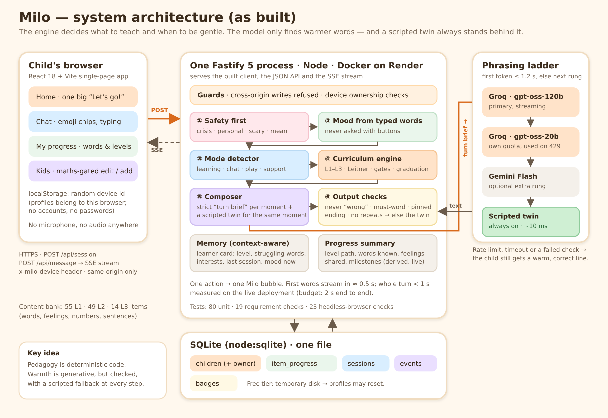

# Milo — System Design (as built)

*An AI English-learning companion for children aged 4–6. This document describes the system as it
is deployed today: what it does, how it is built, why each choice was made, and what it costs us.*

- **Live app:** <https://milo-2f8q.onrender.com/>
- **Source:** <https://github.com/tasnim-rizvy/milo>
- **Diagram:** [`architecture.png`](architecture.png) (source: [`architecture.svg`](architecture.svg))
- The files `01`–`06` in this folder are the original **planning** documents written before the
  build. Where they differ from this document, this one is correct.

---

## 1. The problem and the five requirements

A child under 7 cannot read much, cannot type well and loses interest fast. The product must teach
English step by step, be warm, notice how the child is, remember them, and answer quickly.

| # | Requirement | How the design meets it | Evidence |
|---|---|---|---|
| 1 | **Progressive learning L1 → L3**, harder as the child progresses | A deterministic curriculum engine: 118 items (L1 55, L2 49, L3 14), Leitner spaced repetition (5 boxes), an 80 % mastery gate, a 5-task stage check (pass = 4 of 5), a graduation ceremony | `curriculum.test.js`, requirement checks R1 ×3, browser tour "Aarav promoted L2 → L3" |
| 2 | **Detect the child's mode** and not teach every turn | Rule-based mode detector (learning · conversation · engagement · support) with stickiness; support always pre-empts; typed feelings are tracked | `modes.test.js`, requirement checks R2 ×3 |
| 3 | **Social-emotional learning** | Feelings read from the child's own words, validation, effort praise, "not yet" language, recasts that never say "wrong", a Calm Corner, curiosity puzzles, a progress screen that shows feelings shared | requirement checks R3 ×4, browser tour (calm corner, goodbye) |
| 4 | **Context-aware responses** | A per-child "learner card" (level, struggling words, interests, last session, mood right now) goes into every AI turn; spaced repetition decides what comes back | requirement checks R4 ×2 |
| 5 | **End-to-end latency < 2 s** | Streaming (SSE), a 1.2 s first-token budget with automatic fallback, and a scripted twin for every AI moment | §9 below: 0.5–1.0 s measured on the live deployment |

Hard constraints from the brief: no voice, no microphone, no audio anywhere; no parent-facing
surfaces in the child's UI. Both are enforced by automated checks (`NO-VOICE`, `NO-PARENT`).

---

## 2. Architecture

One Node process serves everything: the built React app, the JSON API and the streaming endpoint.
There are no other services to run besides the optional LLM provider.

| Layer | Choice | Why |
|---|---|---|
| Client | React 18 + Vite, tap-first chat UI | Fast to build; big emoji chips so a non-reader can play; small bundle (≈54 KB gzipped) |
| Server | Node + Fastify 5, one process | One language end to end; first-class streaming; serves the static build too, so one URL and one deploy |
| Streaming | Server-Sent Events over a `POST` (`chunk*` → `turn` → `end`) | First words appear while the rest is generated; works on any HTTP host |
| Data | SQLite via Node's built-in `node:sqlite` | Zero setup, no native build step, one file; fine at this scale |
| AI | Groq `gpt-oss-120b` primary → `gpt-oss-20b` → optional Gemini Flash → scripted twin | Free tiers with very fast first tokens; a ladder survives rate limits |
| Hosting | Docker on Render (free tier) | No card needed; a stable HTTPS URL |

### Component responsibilities

| Component | Owns | Never does |
|---|---|---|
| Curriculum engine (`curriculum.js`, `bank.js`) | Which word comes next, mastery maths, gates, stage check | Generate language |
| Mode detector (`modes.js`) | Learning vs conversation vs play vs support, feeling words | Choose content |
| Session / dialog manager (`session.js`) | Turn state, what answer is expected, retry / scaffold / celebrate, the "one action → one bubble" rule | Decide level rules |
| Safety (`safety.js`) | Crisis / personal / scary / mean input; sanitising model output | Block on latency |
| Composer (`llm/compose.js`) | Builds the strict per-moment **turn brief** and calls the model; runs the output checks | Decide pedagogy |
| Scripted bank (`sel.js`) | A fallback line for every briefed moment, ≥ 3 variants each | Free conversation |
| Progress (`progress.js`) | The "My progress" summary, derived from stored data | Store anything extra |
| Store (`store.js`) | All persistence | — |

**Core principle: pedagogy is deterministic code; warmth is generative.** The model never decides
what to teach, whether an answer was right, or when to move up a level. It only finds friendlier
words for a moment the engine has already defined.

---

## 3. One turn, end to end

1. The child taps a chip or types. The client sends `POST /api/message` with the session id and a
   small input object, plus the `x-milo-device` header.
2. **Guards:** cross-origin writes are refused; the session's child must belong to this device.
3. **Safety first:** the text is classified (crisis → calm support; personal, scary, mean → a
   gentle in-world redirect). This runs before anything else, including the wrap-up.
4. **Mood from words:** a feeling the child states ("I am sleepy", "I am angry") is logged as an
   event and kept as the session's current mood. Feelings are never asked with buttons.
5. **Mode detection** decides learning / conversation / engagement / support, with stickiness so
   Milo does not flip-flop; support pre-empts immediately.
6. **Curriculum / dialog decision:** check the answer (fuzzy matching tolerates typos and phonetic
   spellings), then advance, retry, scaffold or celebrate; update the Leitner box and stars.
7. **Compose:** the engine builds a **turn brief** — a short, strict description of the moment
   ("the child just got *elephant* right on the first try; cheer, no question, end with this exact
   next prompt"). The learner card and the last few turns go with it.
8. **Model call** down the ladder (§6) with a 1.2 s first-token budget; the stream is forwarded to
   the browser as it arrives.
9. **Output checks:** the text must not say "wrong", must contain required words, must end with the
   pinned next prompt, must not repeat the previous line, and must pass the safety sanitiser.
   Any failure sends the **scripted twin** for the same moment instead.
10. **One action → one bubble:** the reply is a single Milo bubble; the next question is merged
    into it. The final `turn` event carries chips, stars, mode and effects (confetti, badge, end card).

A session opens differently: a warm hello plus a tiny two-picture "wonder" puzzle ("What has
WHEELS? 🚗 or 🐟"). Either pick is right and gets a short fact; this builds curiosity and
confidence, and the puzzles favour the child's interests.

---

## 4. Learning design

- **Levels:** L1 first words (greetings, colours, numbers, animals, family, body, size), L2 feelings,
  food, toys, action words, positions and weather, L3 describing words and daily routines with
  sentence building. Tasks vary: tap the word, say it, read it, count, yes / no, build a sentence.
- **Spaced repetition:** each word sits in a Leitner box 1–5; a correct answer moves it up, a miss
  moves it back; due words return first in the next session. A word counts as *learned* at box ≥ 3.
- **Level gate:** ≥ 80 % of the level's words learned, ≥ 80 % first-try correct on the last
  answers (min. 5), and play on ≥ 2 days; then a 5-task stage check (4 of 5 passes) and the
  graduation ceremony (confetti, badge, bonus stars, a sentence-building preview of the next level).
- **Session shape:** warm-up review → teach (model → join in → independent) → play → celebrate →
  wrap. A soft wind-down at 8 minutes and a hard wrap at 12.
- **Scaffolding:** "I don't know" gets a hint ladder (two choices → first letter → show the answer →
  move on, no penalty); three misses in a row trigger a gentle check-in and a demonstration.

---

## 5. Mode detection and social-emotional learning

**Modes.** Tier-1 rules read each input: study refusals and play words → *engagement*; sad, tired,
scared, angry, "I can't", repeated "no" → *support*; questions and chat → *conversation*; answers
→ *learning*. Support pre-empts at once; other modes hold for at least two turns; free chat has a
three-turn budget before Milo bridges back to the lesson.

**SEL in practice**

| Skill | What the system does |
|---|---|
| Emotional awareness | Feelings the child types are recognised (happy, sleepy, sad, angry, scared, worried, lonely), validated, and logged; the L2 curriculum teaches feeling words (happy, sad, angry, tired…); "Feelings I shared" appears on the progress screen |
| Confidence | Effort praise ("you tried again!"), "not *yet*" growth language, recasts instead of "wrong", brave-sharing praise, stars, milestones that unlock early |
| Curiosity | Wonder puzzles at the start, "why / what" answered in one simple sentence plus a tiny wow, chat that mixes ideas and "what if" instead of always asking a question, topics tied to the child's own interests |
| Positive learning behaviour | Retry is always welcome, no penalties, forced wind-downs protect attention, "two more?" instead of nagging, a goodbye ritual with a star summary |

**Calm Corner.** In support mode each tap guides one slow breath, then hands the turn back with
three choices (one more · gentle play · bye). It never lectures.

---

## 6. The AI layer

- **Briefs, not freedom.** Each moment (praise, recast, growth, check-in, breathing, greeting,
  wonder reveal, free chat…) has its own brief. The system prompt fixes the voice: very short,
  simple words, no idioms, never "wrong", comfort first, never repeat the last line, only
  well-known facts and no numbers.
- **Interests as seasoning.** The child's interests are included in the prompt only on a minority of
  chat replies (chosen by code), so Milo mentions them now and then instead of in every line.
- **The ladder.** Groq `gpt-oss-120b` first; on a rate limit, timeout or failed check, `gpt-oss-20b`
  (its own quota); then an optional Gemini key; finally the scripted twin. A 1.2 s first-token
  budget and a 2.5 s total budget keep the 2-second promise.
- **Scripted twin.** Every briefed line has a hand-written equivalent (3–6 variants), which also
  uses the child's interests. If the model is slow, rate-limited, or fails a check, the child still
  gets a warm and *correct* line. With no API key at all, the whole app runs on scripts.
- **Failure visibility.** The cause of a fallback (for example `llm-http-429`) is stored as an
  event; the provider's full error text stays in the server log only, so nothing sensitive is
  exposed to the browser.

---

## 7. Data model

SQLite, one file (`server/data/milo.db`):

| Table | Purpose |
|---|---|
| `children` | Profile: name, age (4–6), avatar, reading band, interests, level, stars, last summary, last seen, **owner** (device id) |
| `item_progress` | Per child and word: Leitner box, correct / wrong, first-try counts, next-due time |
| `sessions` | One row per session: start, end, stars, a state snapshot (so a restart can resume) |
| `events` | Audit and analytics: answers, moods (with source), safety flags, fallbacks, wonder puzzles shown / answered |
| `badges` | Level-graduation badges |

The **My progress** screen is derived live from these tables (level path, words learned and still
practising, days and sessions played, feelings shared, nine milestones), so it is always current and
never stored separately.

---

## 8. Profiles, privacy and security

- **No accounts.** A child is profiled by a short first-run form (name, age 4–6, can they read,
  favourite things). No email, no password, no surname, no birthday.
- **Device-private profiles.** The browser creates a random device id; the server stores it as the
  profile's owner and checks it on every list, play, progress, edit and delete call. Another
  device sees nothing and gets a "not found".
- **Parent corner.** Editing a profile or adding a child sits behind a small maths question (a
  child-proofing gate, not an authentication system).
- **Web security.** No CORS headers (the app is same-origin), cross-origin writes are refused,
  request bodies are size-limited and validated, provider errors are redacted from client-visible
  data, and crisis input is handled before any other logic.
- **Data minimisation.** The only thing sent off the server is the child's chat text, to the LLM
  provider, with no identifiers. There are no ads, links, tracking or sharing.
- **Child autonomy.** Leaving is always one tap (✕ goes straight home); the engine ends sessions
  cleanly in the background.

---

## 9. Latency

The budget is 2 s end to end; the design aims for under 1 s.

| Measured | Where | Result |
|---|---|---|
| Chip turns, text turns (AI on) | Live deployment, from a remote client | **524–977 ms** per turn; session start with AI greeting **884 ms** |
| Scripted-twin turns | Server | ≈ 10 ms |
| Earlier full suite (A chip / B text / C cold start) | Local, Groq live | p95 974 ms / 746 ms / 1290 ms (`tools/evidence/latency.json`) |

Why it holds: streaming shows the first words in about half a second; the model is capped at a
short reply; and a slow model never blocks — after 1.2 s the next rung or the script answers.
The first request after Render's free tier sleeps takes 30–60 s (a hosting limit, not an app limit).

---

## 10. Deployment

- **Render (live):** a Docker web service built from `Dockerfile` and `render.yaml`
  (multi-stage build; production dependencies only). `PORT` comes from the platform; the key
  `GROQ_API_KEY` is set as a secret environment variable. Health check: `GET /api/health`.
- **Run locally:** `npm install && npm run build && npm start` (Node ≥ 22.5).
- **Optional tunnel:** `npm run tunnel` publishes a local run through a Cloudflare quick tunnel.
- **Demo mode:** `npm run start:demo` seeds two preloaded profiles (Maya, Aarav) into a separate
  database for the evidence tools.

---

## 11. Testing and evidence

| What | Count | Where |
|---|---|---|
| Unit and integration tests | 80 | `server/test/` (`npm test`) |
| Live requirement checks | 19 / 19 | `tools/requirement-check.mjs` → `tools/evidence/requirement-check.json` |
| Headless-browser tour | 23 / 23 | `tools/e2e.mjs` → `tools/evidence/` (10 screenshots) |
| Latency suites | A / B / C | `tools/latency.mjs` → `tools/evidence/latency.json` |

---

## 12. Design decisions and trade-offs

| Decision | Alternative | Why we chose it | What it costs |
|---|---|---|---|
| Deterministic engine + generative phrasing | Let an LLM run the lesson | Predictable progression, safe for children, testable, works offline | Less open-ended; every new moment needs a brief and a script |
| A scripted twin for every AI moment | Show an error or wait | The child never waits or sees a failure; free quotas are limited | Two things to keep in sync; fallback lines are plainer |
| Tap-first chat, no voice | Speech in and out | The brief forbids audio; non-readers can still play; no privacy risk | No pronunciation practice |
| Feelings from typed words only | Mood buttons at start and end | Buttons were indirect for 4-year-olds ("sunny = happy?") | A child who only taps never reveals a mood |
| No logins, device-private profiles | Parent accounts | A 5-year-old cannot manage passwords; avoids collecting emails | Clearing browser data loses the profile; no cross-device sync |
| Maths-question gate for edits | PIN or account | Zero friction, no credentials to store | Stops a child, not a determined older sibling |
| SQLite in one file | Postgres | No setup, instant, transactional | Render's free disk is temporary → profiles can reset; not for many writers |
| One Node process | Separate API and web | One URL, one deploy, nothing to wire | Scales vertically only |
| Free LLM tiers (Groq, Gemini) | Paid API | $0 to run | ~200 k tokens a day per model; the script takes over when it runs out |
| Render free tier | Paid host or serverless | Free, stable HTTPS URL, Docker | Sleeps after ~15 min idle (30–60 s wake-up) |
| `node:sqlite` built-in | `better-sqlite3` | No native compile step in Docker | Requires a recent Node |

---

## 13. Limitations and next steps

1. **Durable storage:** move to a persistent disk or a managed database so profiles survive
   restarts, and add a parent PIN and an optional restore code for new devices.
2. **AI capacity:** a paid tier or a second provider key removes the daily quota ceiling; a shorter
   prompt would stretch the free one.
3. **More content:** L3 has 14 items; add stories and role-plays, and a "Milo forgets, you help"
   moment for confidence.
4. **Pronunciation:** an optional, parent-enabled voice mode (outside this brief's scope).
5. **Observability:** an operator dashboard for fallbacks, safety flags and latency percentiles
   (the events are already recorded).
6. **Accessibility:** a settings panel for font size, reduced motion and sound.
